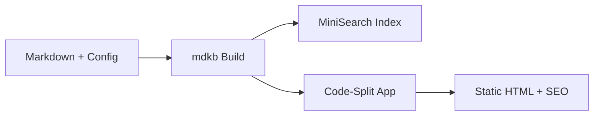

**mdkb** extends standard GitHub-Flavored Markdown (GFM) with frontmatter page configuration and semantic callout boxes.

## Page Configuration (Frontmatter)

Add a YAML frontmatter block at the top of any `.md` file:

```yaml
---
title: My Page Title
description: Concise summary shown below the title and in SEO meta tags.
updatedAt: 2026-11-13
previous:
  label: Previous Page
  link: /previous-page
next:
  label: Next Page
  link: /next-page
---
```

- **`title`**: Sets the page `<h1>` and `<title>` tag.
- **`description`**: Sets the subtitle under `<h1>` and populates `<meta name="description">`, OpenGraph, and Twitter tags.
- **`updatedAt`**: Displays a formatted "Updated" timestamp at the top of the page and `<lastmod>` in `sitemap.xml`.
- **`previous` / `next`**: Customizes the bottom pagination cards (supports `{ label, link }`, a route string, or `false` to hide). If omitted, **mdkb** automatically derives them from `menu` order.

## Callout Boxes (Info, Warning, Danger)

You can author callout boxes using container directives (`:::info`, `:::warning`, `:::danger`) or GitHub-style blockquotes (`> [!INFO]`, `> [!WARNING]`, `> [!DANGER]`).

:::info[Information Box]
Use `:::info[Title]` to highlight helpful context, tips, or non-critical notes. Supports **bold**, `inline code`, and [links](/getting-started).
:::

:::warning[Warning Box]
Use `:::warning[Title]` when readers need to watch out for edge cases, deprecations, or configuration gotchas.
:::

:::danger[Danger Box]
Use `:::danger[Title]` to warn about destructive actions, security risks, or breaking changes.
:::

### Syntax Reference

```markdown
:::info[Optional Title]
Informational message here.
:::

:::warning[Careful]
Warning message here.
:::

:::danger[Destructive Action]
Critical danger notice here.
:::
```

GitHub-style blockquote alerts are also supported:

> [!INFO] GitHub-style Alert
> This blockquote uses `> [!INFO]` syntax and renders with the same accessible Chakra UI alert component.

## Tables & Code Blocks

Every code fence includes a language label and a one-click **Copy** button, and tables automatically scroll horizontally on smaller screens.

| Feature | Syntax | Rendered Component |
| --- | --- | --- |
| Info Callout | `:::info[Title]` | Chakra `Alert` (`info`) |
| Warning Callout | `:::warning[Title]` | Chakra `Alert` (`warning`) |
| Danger Callout | `:::danger[Title]` | Chakra `Alert` (`error`) |
| Mermaid Diagram | ```` ```mermaid ```` | Lazy-loaded `MermaidDiagram` |
| Zoomable Images | `` | Clickable Lightbox modal |
| Headings | `##` / `###` | Anchored headings + right-side TOC |

## Mermaid Diagrams

Fenced code blocks with language `mermaid` are rendered natively as theme-aware SVG diagrams (loaded lazily so pages without diagrams keep a minimal initial bundle):



## Click-to-Zoom Images (Lightbox)

Any standalone Markdown image can be clicked to open in a full-screen lightbox modal (click outside, click the image, or press `Esc` to close). Try clicking the diagram below:


